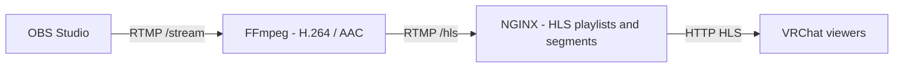

# RTMP → HLS Streaming for VRChat

Stream your desktop, gameplay or media from **OBS Studio** to a **VRChat world video player** through a self-hosted HLS server.

OBS sends one stream. FFmpeg generates the selected qualities, and NGINX serves HLS playlists and media segments to viewers.

## Prerequisites

- Docker Engine or Docker Desktop with Docker Compose v2. The pinned streaming image targets Linux AMD64.
- OBS Studio and CPU capacity for software H.264 encoding.
- A VRChat world video player supporting live HLS on the target platform.
- Sufficient upload bandwidth and network access for viewers.

## Choose a deployment mode

| Mode | Use case | Guide |
| --- | --- | --- |
| **HTTP** | Local testing, LAN viewing or direct public HTTP access on port 8080 | [HTTP setup](docs/http.md) |
| **HTTPS** | Public domain with a TLS reverse proxy, optionally behind Cloudflare | [HTTPS setup](docs/https.md) |

**Start with the [HTTP guide](docs/http.md)** to configure OBS and verify playback. Then follow the HTTPS guide if you want a URL such as `https://stream.example.com/hls/stream.m3u8`.

The HTTPS proxy is optional and enabled with the Compose profile `https`. Encoding quality is selected separately: `STREAM_PROFILE=full` generates six qualities, while `light` generates one 720p quality.
