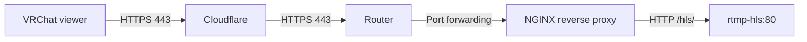

# HTTPS mode

[Back to README](../README.md) · [HTTP mode](http.md) · [Operations and troubleshooting](operations.md)

Use the optional NGINX reverse proxy to serve HLS at `https://stream.example.com/hls/stream.m3u8`. Replace `stream.example.com` with your own hostname throughout this guide.

First verify [local HTTP playback with OBS](http.md#2-configure-obs-and-start-streaming). HTTPS changes how viewers reach the stream; OBS still publishes RTMP to `/stream`.

The proxy terminates TLS and forwards only `/hls/` to `rtmp-hls:80` on the Compose network. It does not publish `/stat` or `/stat.xsl`.



Cloudflare is optional when using a publicly trusted certificate. The Cloudflare-specific instructions below assume a Proxied DNS record.

## 1. Install a certificate

Obtain a certificate covering your hostname and place its PEM files at these paths, relative to the repository root:

```text
reverse-proxy/certificates/stream.crt
reverse-proxy/certificates/stream.key
```

- **Cloudflare Origin CA:** create a certificate under **SSL/TLS → Origin Server → Create Certificate**. Save the origin certificate as `stream.crt` and its matching private key as `stream.key`. The DNS record must remain **Proxied**: these certificates are trusted by Cloudflare, not directly by browsers or VRChat.
- **Public CA, such as Let's Encrypt:** save the full certificate chain as `stream.crt` and the matching private key as `stream.key`. This also supports direct HTTPS access without Cloudflare.

Both files must exist before starting the proxy. They are ignored by Git. This project does not issue or renew certificates automatically.

## 2. Enable HTTPS in `.env`

Copy [`.env.example`](../.env.example) to `.env` if necessary, then set:

```dotenv
STREAM_PROFILE=full
RTMP_BIND_ADDRESS=127.0.0.1
STREAM_DOMAIN=stream.example.com
COMPOSE_PROFILES=https
```

Run commands from the repository root. **Docker Compose automatically reads `.env`.** `COMPOSE_PROFILES=https` activates services marked `profiles: [https]`, so the optional `reverse-proxy` starts alongside `rtmp-hls`. Without an active HTTPS profile, only the streaming service starts by default.

The deployment profile `https` is separate from `STREAM_PROFILE=full` or `light`, which selects encoding qualities.

### If ports 80 or 443 are already occupied

Choose unused host ports in `.env`, for example:

```dotenv
PROXY_HTTP_PORT=8081
PROXY_HTTPS_PORT=8443
```

Otherwise, the defaults are `PROXY_HTTP_PORT=80` and `PROXY_HTTPS_PORT=443`.

| Public router port | Default destination | Alternative destination |
| --- | --- | --- |
| TCP 443 | Docker host port 443 | Docker host port 8443 |
| TCP 80 (redirect) | Docker host port 80 | Docker host port 8081 |

The public URL stays `https://stream.example.com/...`, without `:8443`, because the router translates the external port to the chosen internal port.

A public port-forward can target only one destination. If another application must also remain publicly reachable on port 443 at the same IP, use a shared reverse proxy that routes by hostname instead of replacing its forwarding rule.

## 3. Start and verify the proxy

With `COMPOSE_PROFILES=https` saved in `.env`:

```sh
# Check Compose syntax; this does not check certificates or start services.
docker compose config --quiet

# Apply settings and start both services in the background.
docker compose up -d --force-recreate

# Validate the proxy's NGINX configuration and certificate loading.
docker compose exec reverse-proxy nginx -t

# Inspect startup logs if needed.
docker compose logs --tail=100 reverse-proxy
```

Alternatively, omit `COMPOSE_PROFILES` from `.env` and explicitly enable the profile when starting: `docker compose --profile https up -d`. You do not need to use both methods.

The proxy reaches the streaming service through Docker networking. Port 8080 remains available for direct HTTP checks; public forwarding of it is not required for HTTPS.

## 4. Configure DNS, the router and Cloudflare

1. Point the hostname's DNS A record at your router's public IPv4 address. Enable **Proxied** when using Cloudflare Origin CA.
2. Forward external **TCP 443** to the Docker host's HTTPS port: **443** by default, or **8443** in the alternative example above.
3. Optionally forward external **TCP 80** to the proxy's HTTP port: **80** by default, or **8081** in the alternative example.
4. Allow those connections through the host firewall. For WSL, confirm they reach Docker; see [WSL networking](http.md#wsl-and-docker-desktop).
5. In Cloudflare, set SSL/TLS encryption to **Full (strict)**.
6. Configure a Cloudflare Cache Rule to **bypass cache** for this hostname's `/hls/*` path, so custom caching rules do not serve stale live playlists.

Public forwarding of 8080 and 1935 is not required when viewers use HTTPS and OBS runs locally. Cloudflare's standard HTTP proxy does not transport RTMP ingest on port 1935.

## 5. Verify public playback

**Click Start Streaming in OBS and keep it running.** Wait for the first segments, then test:

```sh
curl -i https://stream.example.com/hls/stream.m3u8
```

Use `curl.exe` on Windows. Expect HTTP `200` and a body starting with `#EXTM3U`. Test video and audio from another network, then enter this URL in the VRChat player:

```text
https://stream.example.com/hls/stream.m3u8
```

## Troubleshooting

| Error | Check |
| --- | --- |
| Port already allocated | Choose free `PROXY_HTTP_PORT` / `PROXY_HTTPS_PORT` values and update router destinations. |
| Cloudflare 526 | Origin certificate hostname, expiry, chain and matching key. Keep Full (strict) and fix the origin certificate. |
| Cloudflare 525 | TLS handshake with the origin; inspect proxy TLS configuration and logs. |
| Cloudflare 521 / 522 | Proxy availability, router forwarding, host/WSL forwarding and firewall. |
| Proxy 502 | HLS container health and Docker-network connectivity; inspect both services' logs. |
| HLS 404 | OBS is publishing, the stream key matches the URL, and the first segments have been generated. |

For player compatibility and encoding performance, see [operations and troubleshooting](operations.md).

## Update certificates or proxy configuration

After replacing certificate files:

```sh
docker compose exec reverse-proxy nginx -t
docker compose exec reverse-proxy nginx -s reload
```

After changing `STREAM_DOMAIN`, port settings or the proxy template, recreate the proxy so its startup command regenerates the configuration:

```sh
docker compose up -d --force-recreate reverse-proxy
```

## Return to HTTP mode

1. Stop the proxy: `docker compose --profile https stop reverse-proxy`.
2. Remove or comment out `COMPOSE_PROFILES=https` in `.env`.
3. Run `docker compose up -d`.

HTTP playback remains available at `http://<host>:8080/hls/stream.m3u8` without certificates. For public HTTP access, configure [port 8080 forwarding](http.md#5-allow-public-http-playback).
